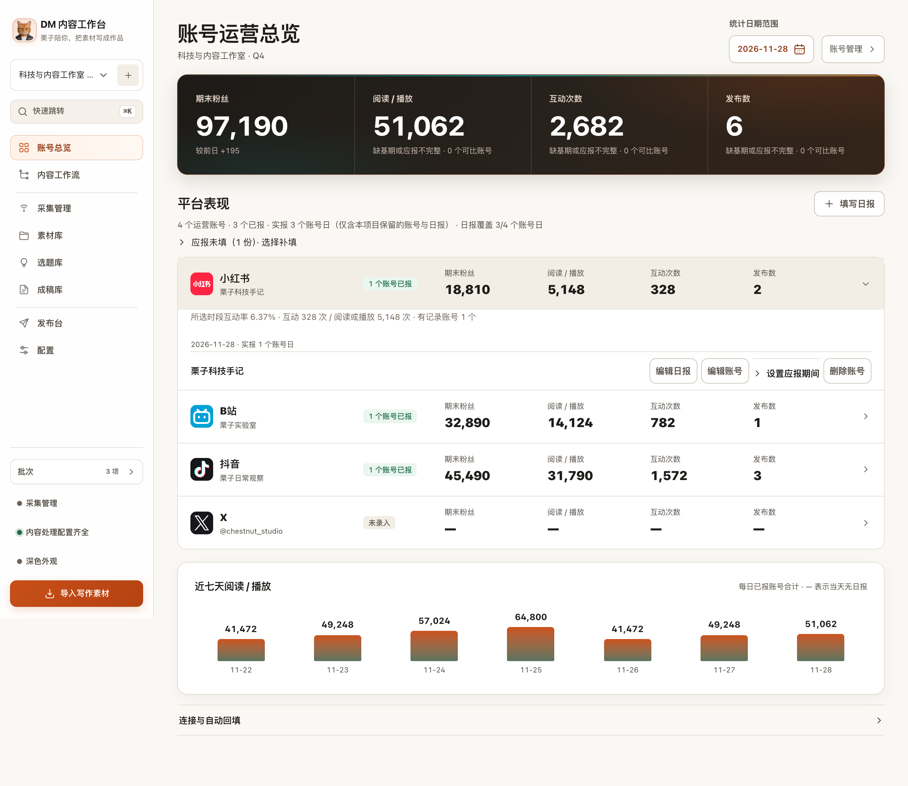
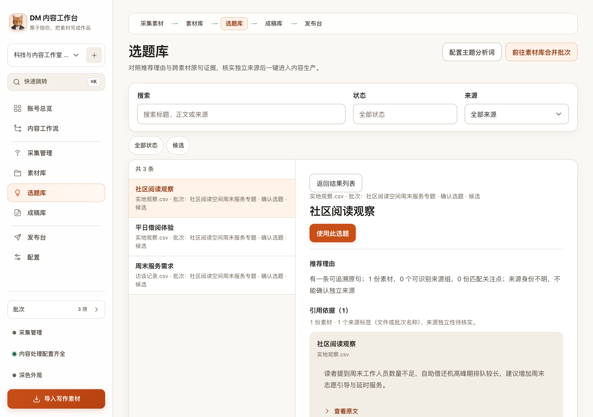
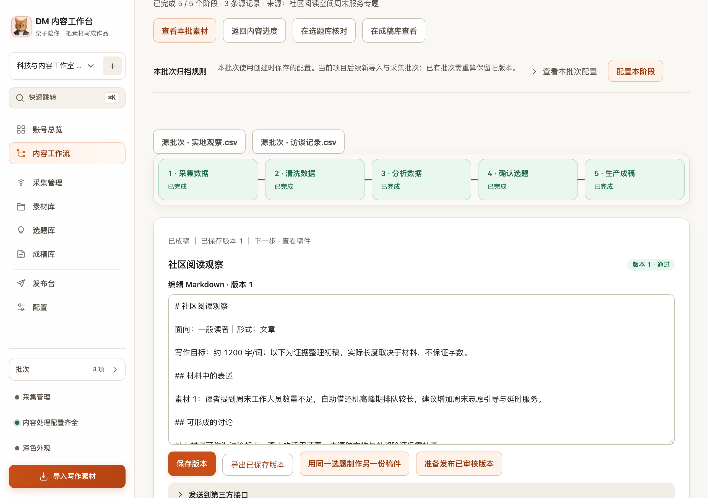
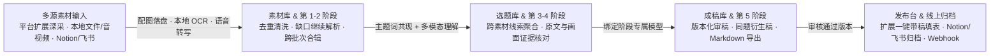

<div align="center">

# DM 内容工作台 (`DM-Content-Workbench`)

**把分散的采访与多平台素材变成有原文依据的选题和定稿 —— 集多平台深度采集、跨素材证据核对、版本审稿归档与账号运营日报于一体**

<p>
  <a href="README.md"></a>
  <a href="README_EN.md"></a>
  <a href="https://github.com/dylanma8232-art/DM-Content-Workbench/releases/latest"></a>
  
  
  
  <a href="LICENSE"></a>
</p>

[核心亮点一览](#核心亮点一览) · [六大功能工作区](#六大功能工作区) · [3 步快速开跑](#3-步快速开跑) · [迭代清单 (v2.0)](#迭代清单-v20) · [可选进阶配置](#可选进阶配置本地-ai线上资料库与浏览器扩展) · [更新日志](CHANGELOG.md)

</div>

---

## 核心亮点一览

做内容创作、深度调研或自媒体矩阵运营时，最耗神的通常不是写字本身，而是三个反复出现的卡点：

1. **素材散落一地，写着写着找不到原话**：采访记录、PDF 报告、音视频转写和网页收藏分散在各处，定选题和终审时很难核对哪句话出自哪份原始材料、哪条结论只是画面观察。
2. **改稿版本一团糟，审核与分发割裂**：来回改了三四版，不知道审过的是哪一版；定稿后还要手动切去不同平台后台复制粘贴。
3. **运营数据天天切后台**：小红书、B 站、抖音、公众号、X 各看各的，缺报漏报难以及时发现，也没法在同一张面板里对照近七天曝光与互动趋势。

**`DM-Content-Workbench`** 把 **「多平台账号运营总览 + 浏览器扩展深采与多模态解析 + 跨素材原文证据选题 + 版本审稿归档与一键带稿分发」** 收进一个纯本地 SQLite 工作台（内置栗子 IP 暖石白与黑曜石深色双主题），不依赖外部云账号即可闭环跑通全流程。

### 1. 多平台账号运营总览 + 缺报雷达一键补填

同一块黑曜石暖铜指标舱内汇总各平台**期末粉丝（含较前日净增）、阅读/播放、互动次数、发布数与近 7 天趋势**；自动识别统计时段内的「应报未填」账号并支持一键点选补填，配套浏览器扩展还可在已登录的抖音创作者中心预览并回填运营日报。

<p align="center">
  
  <br><sub><b>账号运营总览</b>：小红书、B 站、抖音、公众号、X 等多平台数据与近 7 天趋势同屏汇总，支持手动录入、缺报直达补填、抖音扩展回填与接口拉取</sub>
</p>

### 2. 跨素材原文证据选题 + 五阶段版本审稿与一键带稿分发

<table>
  <tr>
    <td width="50%" valign="top">
      
      <br>
      <b>跨素材线索聚合与原文核对</b>：自动将多批次素材聚合为候选选题，每条推荐理由均附带原文摘录、独立来源统计与一键回溯原始素材，严格区分「作者原话」与「画面观察」。
    </td>
    <td width="50%" valign="top">
      
      <br>
      <b>五阶段流水线与版本审稿导出</b>：<code>采集 → 清洗 → 分析 → 选题 → 成稿</code> 五步闭环，审核结论严格绑定具体版本号，支持同题衍生多稿、归档至 Notion/飞书多维表格，或一键带稿填入各平台发布页。
    </td>
  </tr>
</table>

---

## 六大功能工作区

通过左侧导航轨（或键盘 `⌘K / Ctrl+K` 栗子快搜）在六大工作区与深浅外观之间一键切换：

| 工作区 | 主要用途 |
|---|---|
| **`账号总览`** | 按单日或自定义日期范围汇总各平台粉丝、阅读/播放、互动率与发布数；管理账号名册与应报期间，自动列出「应报未填」账号一键补填 |
| **`内容工作流`** | 顶部五步生产链路直达条 + 五阶段导管看板（待清洗 / 待分析 / 待选题 / 待写稿 / 已成稿），内置「继续处理」手记焦点舱与每日批次进度 |
| **`采集管理`** | 支持**平台深采任务**（小红书/B 站/抖音/YouTube/X/Instagram/TikTok 4 步实时数据流）、**本地文件导入**（CSV/TXT/PDF/音视频）与**线上资料库连接**（Notion / 飞书多维表格） |
| **`素材库 / 选题库 / 成稿库`** | 全量检索已入库素材（支持浮动素材篮勾选合并专题、对缺口素材一键「继续解析」）、核对候选选题原文证据、管理历次审核成稿 |
| **`发布台`** | 集中展示「待发布 / 已填入待确认 / 已发布」稿件，选择目标平台与绑定账号后，联动浏览器扩展一键打开平台发布页并自动填入标题与正文草稿 |
| **`配置中心`** | 独立管理多组大模型服务凭据（可为「内容理解与选题」和「稿件生成」分别绑定不同模型）、检测本机 OCR / Whisper 转写引擎状态、管理数据存储目录与第三方接口 |

---

## 3 步快速开跑

### 第 1 步：启动本地工作台（默认地址 `http://127.0.0.1:8765`）

- **macOS 双击一键启动（推荐）**：克隆或解压后，直接双击根目录的 [`启动工作台.command`](启动工作台.command)。脚本会自动创建虚拟环境、安装依赖、拉起本地服务并打开浏览器。
- **macOS / Linux / Windows 命令行启动**（需安装 `Python 3.12`）：

```bash
git clone https://github.com/dylanma8232-art/DM-Content-Workbench.git
cd DM-Content-Workbench

python3.12 -m venv .venv
.venv/bin/python -m pip install -r requirements.txt
.venv/bin/python tools/start_local_workbench.py --no-browser
```

> Windows PowerShell 可运行：`py -3.12 -m venv .venv`，再执行 `.venv\Scripts\python.exe -m pip install -r requirements.txt` 与 `.venv\Scripts\python.exe tools\start_local_workbench.py`。

### 第 2 步：首次引导建项（纯本机零配置，或直连 Notion / 飞书）

浏览器打开 `http://127.0.0.1:8765`：
- 选择 **「先使用本机」**：无需配置任何数据库密码或云账号，输入项目名称即可直接进入工作台（也可在引导页顺手创建首条平台采集任务）。
- 选择 **「连接 Notion」或「连接飞书多维表格」**：按向导填入集成密钥与资料库链接，检测读取权限通过后即可一键将线上资料库导入本地素材库。

### 第 3 步：导入素材或开启平台深采，跑通五步成稿

1. 点击左下角 **「导入写作素材」**（可直接点「填入合成示例」1 秒体验），或在 **「采集管理」** 新建平台深采任务；
2. 在 **「素材库」** 勾选多份素材合并专题，推进 **清洗 → 分析 → 选题**，在 **「选题库」** 核对跨素材原文证据；
3. 生成初稿并在第 5 阶段完成 **版本审核**，一键导出 Markdown、归档至 Notion/飞书，或送入 **「发布台」** 带稿发布。

---

## 迭代清单 (v2.0)

本轮 `v2.0` 围绕**视觉科技感、用户操作手顺、栗子 IP 统一、多模态采集与发布闭环**完成了全方位升级（完整细节见 [`CHANGELOG.md`](CHANGELOG.md)）：

- **栗子 IP 科技感 UI 与深浅双主题**：
  - 全站统一暖石白工作台底色（`#FAF8F4`）与黑曜石暖铜总览舱，新增 **`html[data-dm-theme="dark"]` 黑曜石深色工作室模式**（导航栏左下角与 `⌘K` 快搜一键切换）。
  - 配套 Chrome/Edge 浏览器扩展弹窗（`popup.html`）与抖音绑定页（`douyin-connect.html`）全面升级为自包含黑曜石暖铜卡片 + 内联栗子 IP 头像 + 动态数据流脉冲条。
- **实时数据流管线与高频交互打磨**：
  - 内容工作流、三库与发布台顶部新增**五步生产链路直达条**，五阶段卡片以科技青色导管相连；采集任务卡片内置 **4 步实时数据流节点条**（`列表探针 → 详情与展开 → 字幕/语音转写 → 画面 OCR 与入库`）。
  - 批次详情页滚动时五阶段进度条**毛玻璃吸顶**；素材库勾选合辑时自动升起**底部浮动毛玻璃操作坞**；近 7 天图表支持悬停高对比度数据浮层；所有展开卡片与弹窗支持 `ESC` 一键收起。
- **多模态深采、本地 OCR/ASR 与缺口继续解析**：
  - 支持图文配图落盘 + Apple Vision / Tesseract OCR 识图、视频字幕提取 + 本地 Whisper.cpp / MLX 语音转写 + 关键帧多模态解析；素材库透明展示未完成项，支持历史批次一键「继续解析」。
- **线上资料库双向连接与选号带稿发布**：
  - 新增 Notion 与飞书多维表格「读取导入素材库 + 审核通过成稿一键归档」双闭环；新增「发布台」按平台与账号联动浏览器扩展自动填入草稿并回传确认状态。

---

## 系统工作流与架构全景



---

## 可选进阶配置（本地 AI、线上资料库与浏览器扩展）

基础工作流、本地规则分析、模板成稿与账号日报**开箱即用，无需配置任何外部密钥**。需要接入大模型、本地语音转写或浏览器扩展时，可直接在页面点击设置，无需手写配置文件：

### 1. 多模型服务凭据与本机 OCR / 语音转写

在 **「配置 → AI 与内容处理」** 中：
- **多组大模型凭据管理**：支持添加任意 OpenAI 兼容接口（DeepSeek、通义千问、OpenAI、Kimi、硅基流动或本机 Ollama `http://127.0.0.1:11434/v1`），并可为 **「第 3 阶段：内容理解与选题」** 和 **「第 5 阶段：稿件生成」** 分别指定不同模型与温度参数，内置「测试连接」实时校验。
- **本机多媒体引擎一键启用**：支持在页面或通过 `python tools/start_local_workbench.py --setup-local-ai` 一键拉起本机 OCR（macOS 原生 Apple Vision / Tesseract）与本机语音转写服务（`whisper.cpp` / `mlx-whisper`）。

### 2. 配套 Chrome / Edge 浏览器扩展（深采 + 带稿填表 + 抖音日报回填）

1. 打开 Chrome 或 Edge 的 `chrome://extensions`，开启右上角 **「开发者模式」**；
2. 点击 **「加载已解压的扩展程序」**，选择本仓库下的 [`tools/publish-extension`](tools/publish-extension) 目录；
3. 扩展仅在你在工作台点击「去登录并继续」「去平台填写并确认」或「连接抖音自动回填」时，在当前已登录页面执行结构化读取或草稿框填充，**绝不读取无关标签页或自动点击发布按钮**。

<details>
<summary><b>3. 环境变量、Docker 自托管、备份恢复与自动化测试速查（点击展开）</b></summary>

| 环境变量 | 用途 |
|---|---|
| `DM_DATA_DIR` | 数据目录，默认 `.dm-data`（也可在「配置 → 数据存储」可视化一键迁移 SQLite 到新目录） |
| `DM_MODEL_BASE_URL` / `DM_MODEL_NAME` / `DM_MODEL_KEY` | 默认 Chat Completions 接口地址、模型名与密钥（支持在界面「配置」中直接可视化保存） |
| `DM_ASR_BASE_URL` / `DM_ASR_MODEL` / `DM_ASR_KEY` | 兼容 OpenAI `/v1/audio/transcriptions` 的音频转写接口配置 |
| `DM_OCR_ENABLED` / `DM_OCR_LANG` | 设为 `1` 开启 PDF 扫描页 OCR；语言默认 `eng`，可选 `chi_sim` 或 `chi_sim+eng` |

- **Docker Compose 自托管**：根目录执行 `docker compose up --build -d --wait`，数据持久化在 `workbench` 卷。
- **数据库备份与恢复**：
  ```bash
  python backup.py export workbench-backup.sqlite3
  python backup.py restore workbench-backup.sqlite3 --directory restored-workspace
  ```
- **全套自动化测试与纯净打包**：
  ```bash
  .venv/bin/python -m unittest discover -s tests -p "test_*.py"
  node --test tools/publish-extension/*.test.mjs
  .venv/bin/python tests/browser_acceptance.py
  .venv/bin/python tools/build_release.py
  ```

</details>

---

## 使用许可

本项目采用 **[CC BY-NC-SA 4.0](LICENSE)**（知识共享 署名-非商业性使用-相同方式共享 4.0 国际）协议开源，仅供个人学习与非商业研究使用，**严禁任何形式的商业使用、付费社群分发或打包售卖**；修改与再分发需保留原作者署名并沿用相同协议。详见 [LICENSE](LICENSE) 与 [第三方声明](NOTICE)。

> 平台标志采用 Simple Icons 13.21.0 的图形（CC0），品牌商标归各自权利人所有。

---

## 关于作者

作者：**[dylanma8232-art](https://github.com/dylanma8232-art)** · **[返回个人主页查看更多开源项目 →](https://github.com/dylanma8232-art)**
