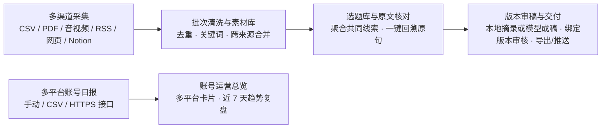

<div align="center">

# 内容工作台 (`DM-Content-Workbench`)

**把分散的采访与素材变成有原文依据的选题和定稿，同时在一个页面看齐各平台账号运营日报**

<p>
  <a href="README.md"></a>
  <a href="README_EN.md"></a>
  
  
  <a href="LICENSE"></a>
</p>

[核心亮点一览](#核心亮点一览) · [3 步快速上手](#3-步快速上手) · [功能模块速查](#功能模块速查) · [进阶配置与运维](#进阶配置与运维) · [使用许可](#使用许可)

</div>

---

## 为什么需要它？

做内容创作或自媒体运营时，最耗神的通常不是写字本身，而是三个反复出现的卡点：

1. **素材散落一地，写着写着找不到原话**：采访记录、PDF 报告、音视频转写和网页摘录分散在不同文件夹里，定选题和终审时很难核对哪句话出自哪份原始材料。
2. **改稿版本一团糟，审核意见对不上号**：来回改了三四版，不知道审过的是哪一版，同题衍生稿也容易互相覆盖。
3. **运营数据天天切后台**：公众号、小红书、B 站、抖音各看各的，没法在同一张面板里对照近七天趋势，也难以把内容产出和账号表现连起来复盘。

**内容工作台**把「多平台账号日报 + 素材采集清洗 + 跨素材原文核对 + 版本审稿导出」收进一个纯本地 SQLite 工作台，不依赖外部云账号也能跑通全流程，需要时再按需接上大模型、Notion 或第三方接口。

---

## 核心亮点一览

<p align="center">
  
  <br><sub><b>账号运营总览</b>：公众号、小红书、B 站、抖音等平台数据与近 7 天趋势同屏汇总，支持手动录入、CSV 导入与第三方接口拉取</sub>
</p>

<table>
  <tr>
    <td width="50%" align="center" valign="top">
      
      <br><sub><b>选题与原文核对</b>：跨多份原始素材自动聚合共同线索，每条推荐理由都带原文摘录与一键回溯原始素材</sub>
    </td>
    <td width="50%" align="center" valign="top">
      
      <br><sub><b>版本审稿与导出</b>：采集 → 清洗 → 分析 → 选题 → 成稿五步闭环，审核结论绑定具体版本，支持 Markdown 导出与第三方推送</sub>
    </td>
  </tr>
</table>

---

## 3 步快速上手

需要 **Python 3.12**（本地 SQLite 自动初始化，无需配置数据库或云账号）：

```bash
# 1. 创建并激活虚拟环境，安装依赖
python3 -m venv .venv
.venv/bin/python -m pip install -r requirements.txt

# 2. 启动工作台服务
.venv/bin/python -m uvicorn app:app --host 127.0.0.1 --port 8765

# 3. 浏览器打开 http://127.0.0.1:8765，点击「初始化工作台」即可开始
```

> **Windows 提示**：用 `py -3.12 -m venv .venv` 创建环境，后续把 `.venv/bin/python` 换为 `.venv\Scripts\python.exe`。  
> **Docker 一键启动**：装有 Docker Compose 2.24.0+ 时，仓库根目录直接运行 `docker compose up --build -d --wait`，浏览器访问 `http://127.0.0.1:8765`。

---

## 功能模块速查



| 模块 | 核心能力 |
|---|---|
| **账号总览** | 按日期查看各平台粉丝、阅读/播放、互动、发布数及近 7 天趋势；支持手动录入、CSV 导入与第三方 GET 接口拉取 |
| **每日工作流** | 集中展示当前批次进度、待确认选题与待审稿件，打开任意批次即可接着上次进度继续 |
| **采集渠道与导入** | 支持 CSV/TXT、PDF（含可选 OCR 扫描页）、音视频（FFmpeg + 转写接口）、HTTPS RSS/Atom、静态网页、JSON API 与 Notion 数据库 |
| **素材库** | 支持按关键词与日期检索、清洗对照、跨来源勾选合并为新的分析批次 |
| **选题库** | 跨素材按自选主题和重复线索推荐候选选题，列出每条建议对应的原始摘录并支持直达原文 |
| **成稿库与审稿** | 支持本地摘录或大模型生成草稿；审核决定严格绑定稿件版本，同题衍生稿各自保留完整版本历史，支持导出 Markdown 或推送 Webhook |

---

## 进阶配置与运维

以下内容默认无需配置即可本地使用，按需展开查看：

<details>
<summary><b>1. 环境变量与本地 <code>.dm.env</code>（模型 / Notion / 转写 / OCR / 数据目录）</b></summary>

复制 `.dm.env.example` 为 `.dm.env`（已纳入 `.gitignore`，不会随备份导出），启动时在 `uvicorn` 命令末尾加 `--env-file .dm.env`。在页面「配置 → AI 与多媒体引擎」可直接校验存储目录、模型连通性、Notion 权限及 OCR/转写就绪状态。

| 环境变量 | 用途 |
|---|---|
| `DM_DATA_DIR` | 初始数据目录和存储位置配置所在目录，默认 `.dm-data`（也可在「配置 → 数据存储」一键迁移 SQLite 到新目录） |
| `DM_MODEL_BASE_URL` | Chat Completions 接口根地址（通常以 `/v1` 结尾） |
| `DM_MODEL_NAME`、`DM_MODEL_KEY` | 模型标识及可选密钥 |
| `DM_NOTION_TOKEN` | 自建 Notion Integration 凭据（需在 Notion 将目标库授权给它） |
| `DM_ASR_BASE_URL` | 兼容 OpenAI 音频转写的接口根地址（通常以 `/v1` 结尾） |
| `DM_ASR_MODEL`、`DM_ASR_KEY` | 转写模型标识及可选密钥 |
| `DM_OCR_ENABLED`、`DM_OCR_LANG` | 设为 `1` 开启 PDF 扫描页 OCR（需安装 Poppler 与 Tesseract）；语言默认 `eng`，可选 `chi_sim` 或 `chi_sim+eng` |
| `DM_RSS_TRUSTED_HOSTS` | 可选，逗号分隔的信任订阅主机名（默认仅允许解析至公网的 HTTPS 地址且不跟随重定向） |

</details>

<details>
<summary><b>2. 多媒体导入与自动采集细节（PDF / 音视频 / RSS / JSON API）</b></summary>

- **PDF 与音视频**：PDF 按页提取（上限 10 MB、200 页；启用 OCR 后可识别最多 20 页无文本层扫描页）；音视频通过 FFmpeg 抽取音轨后送至自配转写服务（上传上限 25 MB）。工作区只存提取后的文本与文件名，原始二进制文件由你自行保管。
- **定时采集源**：支持 HTTPS RSS/Atom、静态网页（抽取可读正文）、JSON API（GET，支持记录路径、字段映射、稳定 ID、同源下一页 URL 及 `DM_API_TOKEN_*` Bearer 鉴权，每轮最多 10 页 / 2000 条）与 Notion 数据库。刷新间隔设为 `0` 表示手动，非零值在服务运行期间定期拉取，按条目标识和内容指纹识别新增、变更与重复。

</details>

<details>
<summary><b>3. Notion 双向快照与第三方日报 / 稿件 Webhook 接口</b></summary>

- **Notion 快照**：使用 `2022-06-28` 数据库 API；每次送达保存可回读的 JSON 业务快照（含原始记录、分析、选题、稿件与版本，单快照上限约 350 KB），支持冲突检测与按快照页面 ID 恢复独立本地运行。
- **第三方日报来源（GET）**：在「配置 → 第三方连接」配置 HTTPS 地址与 `DM_API_TOKEN_*` 环境变量名，映射平台、账号、日期、期末粉丝、阅读/播放、互动、发布 7 个字段（支持同源翻页，最多 10 页 / 2000 条），预览确认后更新日报。
- **第三方稿件接收端（POST）**：审核通过后可手动推送 JSON（含 `schema_version=1`、`event="draft.approved"`、`project_id`、`run_id`、`version`、`title`、`markdown`），携带 `Idempotency-Key` 方便接收端幂等去重。

</details>

<details>
<summary><b>4. 云端自托管（Docker Compose）、备份恢复、验收测试与打包分发</b></summary>

- **Docker 自托管**：根目录运行 `docker compose up --build -d --wait`，数据默认落在 `workbench` 持久卷（`/data`）。云主机建议保持监听 `127.0.0.1:8765`，通过 SSH 端口转发安全访问：`ssh -N -L 8765:127.0.0.1:8765 user@server`。
- **单实例边界**：单进程监听本机回环地址，同一实例内所有项目共享服务环境变量与本机凭据，项目用于业务分类，不作为多用户权限隔离边界。
- **备份与恢复**：
  ```bash
  python backup.py export workbench-backup.sqlite3
  python backup.py restore workbench-backup.sqlite3 --directory restored-workspace
  ```
- **单元测试与浏览器验收**：
  ```bash
  python -m unittest discover -s tests -v
  python tests/browser_acceptance.py   # 需安装 playwright 与 Chrome，全程使用临时库
  ```
- **打包纯净分发包**：运行 `python tools/build_release.py` 生成 `dist/DM-Content-Workbench.zip`（仅打包代码、示例配置、说明与测试，不含本机数据库、备份或连接凭据）。

</details>

---

## 使用许可

本项目采用 **[CC BY-NC-SA 4.0](LICENSE)**（知识共享 署名-非商业性使用-相同方式共享 4.0 国际）协议，仅供个人学习与非商业用途使用，**禁止商业使用或打包售卖**；修改与再分发需保留署名并沿用相同协议。详见 [LICENSE](LICENSE) 和 [第三方声明](NOTICE)。

> 平台标志采用 Simple Icons 13.21.0 的图形（CC0），品牌商标归各自权利人所有。

## 关于作者

作者：**[dylanma8232-art](https://github.com/dylanma8232-art)** · **[返回个人主页查看更多开源项目 →](https://github.com/dylanma8232-art)**
