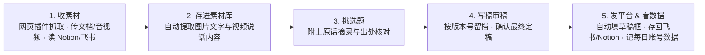

<div align="center">

# DM 内容工作台 (`DM-Content-Workbench`)

**平时收集素材、出选题、写稿审稿、发平台和统计各账号数据，都在这一个页面里搞定**

<p>
  <a href="README.md"></a>
  <a href="README_EN.md"></a>
  <a href="https://github.com/dylanma8232-art/DM-Content-Workbench/releases/latest"></a>
  
  
  
  <a href="LICENSE"></a>
</p>

[它是干什么的？](#它是干什么的) · [三大核心能力](#三大核心能力) · [六个页面分别干嘛](#六个页面分别干嘛) · [3 步快速跑起来](#3-步快速跑起来) · [可选进阶设置](#可选进阶设置接大模型装浏览器插件与同步资料库) · [历史版本记录](https://github.com/dylanma8232-art/DM-Content-Workbench/releases)

</div>

---

## 它是干什么的？

平时做内容创作、自媒体运营或者写深度调研，最烦人的往往不是写字本身，而是三件天天浪费时间的事：

1. **素材存得到处都是，写稿时找不到原话在哪**：小红书/B站/抖音收藏的帖子、采访录音、PDF 报告散在不同地方；真到写稿或者有人问「这句话是谁说的」，翻半天找不到出处。
2. **改稿改出好几版，发平台还要到处复制粘贴**：一篇稿子来回改了三四版，分不清哪版才是审过的最终版；定稿之后还得打开各个平台的后台，一遍遍手动复制标题和正文。
3. **每天统计账号数据要切七八个后台**：手里管着小红书、B 站、抖音、公众号好几个号，每天看涨粉、播放和互动得挨个切网页，哪个号忘了记数据也很难发现。

**`DM 内容工作台`** 就是把这三件事收进**你电脑本地的一个网页工具**里：
**先帮你把各处看中的帖子、视频和文档收进来提取出文字 → 挑出有原话依据的选题 → 写成稿子按版本审好 → 一键带去平台发布页填好草稿，顺带在一张表里看齐所有账号每天的运营数据。** 数据全存在你自己的电脑里，不绑任何云账号，装好就能用。

---

## 三大核心能力

### 1. 所有平台账号每天涨了多少粉、播了多少次，一屏看齐

不用天天挨个登后台：在一个页面里就能看清小红书、B 站、抖音、公众号、X 等各平台账号的**粉丝数（自动算比昨天涨了多少）、阅读/播放量、互动数、发文数和近 7 天走势**。哪个账号今天忘了填数据会自动列出来提醒，点一下就能补填；装了配套浏览器插件后，还能直接从已登录的抖音创作者后台读取日报数据。

<p align="center">
  
  <br><sub><b>账号运营总览</b>：多平台粉丝、播放、互动与近 7 天走势同屏汇总，漏填账号自动提醒、点一下就能补填</sub>
</p>

### 2. 每个选题都能点开看「原话出自哪」，审完的定稿一键带去平台发

<table>
  <tr>
    <td width="50%" valign="top">
      
      <br>
      <b>出选题带原话出处，不怕瞎编</b>：把多篇素材放一起，自动帮你想出几个值得写的选题方向。每个选题下面直接挂着原始素材里的原话摘录和画面内容，点一下就能跳回原文核对，再也不用怕找不到出处。
    </td>
    <td width="50%" valign="top">
      
      <br>
      <b>按版本审稿，定稿一键带去平台填表</b>：每次改稿自动存成新版本（v1、v2、v3…），哪一版通过了审核清清楚楚；审过的定稿可以一键存进 Notion / 飞书表格，或者自动打开平台发布页帮你把标题和正文填进草稿框。
    </td>
  </tr>
</table>

---

## 六个页面分别干嘛

打开工作台后，左边栏只有 6 个页面（也可以随时按键盘 `⌘K` / `Ctrl+K` 搜你想干的事，或切换浅色/深色外观）：

| 页面 | 大白话说明 |
|---|---|
| **`账号总览`** | 看所有平台账号的粉丝、播放、互动和近 7 天走势；管账号名单，哪个号漏记了日报点一下直接补填 |
| **`采集管理`** | 把外部内容收进来：支持用浏览器插件抓小红书/B站/抖音/YouTube/X 等已打开页面的图文和视频文字，也支持导入 Notion / 飞书表格或定时订阅网页 |
| **`素材库`** | 集中放你收进来的所有资料（支持直接传文档、PDF、录音、视频），自动把图片上的字和视频里说的话转成文字，勾选几篇就能送去出选题 |
| **`选题库`** | 看系统从素材里提炼出的候选题目，点开就能核对每条结论对应的原话摘录，挑中满意的题目直接点「去写稿」 |
| **`成稿库`** | 在这里写稿、改稿、审稿。每次修改都留着历史版本，也能用同一个选题衍生出不同平台的稿子，支持导出 Markdown 或存到 Notion / 飞书 |
| **`发布台`** | 挑一篇已经审核通过的定稿，选好要发哪个平台、哪个账号，点一下就能联动浏览器插件打开对应后台并把标题和正文填好（最后点发布的按钮留给你自己确认） |



---

## 3 步快速跑起来

需要电脑已安装 **Python 3.12**（全程在本地运行，不需要注册任何云账号）：

### 第 1 步：下载代码

```bash
git clone https://github.com/dylanma8232-art/DM-Content-Workbench.git
cd DM-Content-Workbench
```

### 第 2 步：启动工作台（默认网址 `http://127.0.0.1:8765`）

- **macOS 最省事启动方式（推荐）**：直接双击文件夹里的 [`启动工作台.command`](启动工作台.command)，会自动装好运行环境并打开浏览器。
- **命令行启动（macOS / Windows / Linux 通用）**：
  ```bash
  python3.12 -m venv .venv
  .venv/bin/python -m pip install -r requirements.txt
  .venv/bin/python tools/start_local_workbench.py
  ```

### 第 3 步：打开浏览器直接用

浏览器会自动打开 `http://127.0.0.1:8765`。第一次进入时选 **「先使用本机」**、填个名字就能直接开始用。

---

## 可选进阶设置（接大模型、装浏览器插件与同步资料库）

不配任何密钥也能跑通全流程。如果你想让大模型帮你深度拆素材写稿、或者用浏览器插件抓页面和自动填发布草稿，直接在网页左下方点 **「配置」** 就能设好：

### 1. 接入大模型与本机图片识字 / 语音转文字

打开工作台左下角 **「配置 → AI 与内容处理」**：
- **接大模型 API**：支持填 DeepSeek、通义千问、OpenAI、Kimi、硅基流动，或者你电脑本地跑的 Ollama（`http://127.0.0.1:11434/v1`）。还能给「拆素材出选题」和「写初稿」分别选不同的模型，填完点 **「测试连接」** 当场就能看到通不通。
- **本机图片识字与语音转写**：上传带字的截图、扫描 PDF 或音视频时，可在同一页面一键开启电脑自带的图片识字（OCR）和本地语音转文字，不用花钱调外部语音接口。

### 2. 安装配套浏览器插件（抓平台帖子 + 自动填发布页草稿 + 读抖音日报）

1. 打开 Chrome 或 Edge 浏览器，在地址栏输入 `chrome://extensions` 并回车，打开右上角的 **「开发者模式」**；
2. 点击左上角 **「加载已解压的扩展程序」**，选择本文件夹里的 [`tools/publish-extension`](tools/publish-extension) 目录；
3. 装好后，只有在你主动点工作台里的「去读取」「去平台填写并确认」或「连接抖音自动回填」时，插件才会帮你读当前打开的页面或往草稿框里填字，**绝不会偷偷在后台乱读其他网页，也不会替你点最终的发布按钮**。

### 3. 连接 Notion 或飞书多维表格

如果你平时习惯把资料存在 Notion 或飞书多维表格，可以在 **「采集管理 → 按渠道采集 → 资料库」** 里填好连接，一键把线上表格里的资料导进素材库；稿子在工作台审核通过后，也能在「成稿库」里一键存回你的 Notion 或飞书表格。

<details>
<summary><b>4. Docker 部署、数据备份与命令行参数（点击展开）</b></summary>

- **搬家或改数据存放位置**：默认所有数据存在项目下的 `.dm-data` 文件夹，也可以直接在页面「配置 → 数据存储」里可视化一键搬到别的文件夹。
- **备份与恢复整个工作台数据**：
  ```bash
  python backup.py export workbench-backup.sqlite3
  python backup.py restore workbench-backup.sqlite3 --directory restored-workspace
  ```
- **用 Docker 启动**：在项目根目录执行 `docker compose up --build -d --wait`，然后打开 `http://127.0.0.1:8765`。
- **跑全套自动化自检**：
  ```bash
  .venv/bin/python -m unittest discover -s tests -p "test_*.py"
  node --test tools/publish-extension/*.test.mjs
  .venv/bin/python tests/browser_acceptance.py
  ```

</details>

---

## 使用许可

本项目采用 **[CC BY-NC-SA 4.0](LICENSE)**（知识共享 署名-非商业性使用-相同方式共享 4.0 国际）协议开源，仅供个人学习与非商业使用，**严禁任何形式的商业使用、付费社群分发或打包售卖**；修改与再分发需保留原作者署名并沿用相同协议。详见 [LICENSE](LICENSE) 与 [第三方声明](NOTICE)。

> 平台标志采用 Simple Icons 13.21.0 的图形（CC0），品牌商标归各自权利人所有。

---

## 关于作者

作者：**[dylanma8232-art](https://github.com/dylanma8232-art)** · **[返回个人主页查看更多开源项目 →](https://github.com/dylanma8232-art)**
