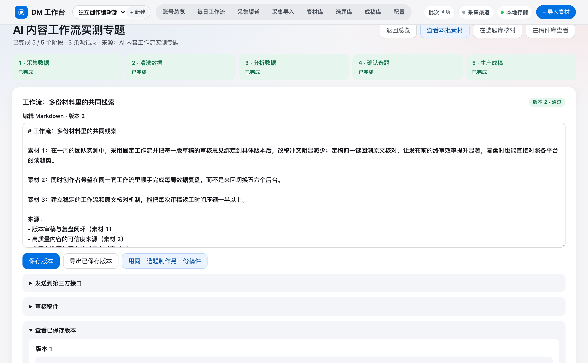

<div align="center">

# DM Content Workbench (`DM-Content-Workbench`)

**Collect materials, find quote-backed topics, review draft versions, fill publishing forms, and track daily account stats — all in one local web workspace**

<p>
  <a href="README.md"></a>
  <a href="README_EN.md"></a>
  <a href="https://github.com/dylanma8232-art/DM-Content-Workbench/releases/latest"></a>
  
  
  <a href="LICENSE"></a>
</p>

[What It Does](#what-it-does) · [Key Features](#key-features) · [Quick Start](#quick-start) · [Releases](https://github.com/dylanma8232-art/DM-Content-Workbench/releases) · [License](#license)

</div>

---

## What It Does

When creating content or running multiple social media accounts, three daily headaches slow everything down:

1. **Materials are scattered everywhere, making it hard to verify original quotes**: saved posts, interview audio, and PDFs live in different folders; when writing, you can't remember where a specific quote came from.
2. **Draft revisions get messy, and publishing requires repetitive copy-pasting**: after three or four edits, nobody knows which version was approved, and you still have to copy-paste titles and body text into each platform's creator studio.
3. **Checking daily account metrics means switching across a dozen tabs**: tracking follower growth, views, and engagement across Xiaohongshu, Bilibili, Douyin, WeChat, and X takes too many logins, and missed daily entries go unnoticed.

**`DM Content Workbench`** brings the entire workflow into a single local web app on your computer:
**collect posts/files and extract text from images & audio → generate topic ideas backed by original quotes → write and approve versioned drafts → fill creator studio forms in one click, while tracking all your accounts' daily stats on one dashboard.**

---

## Key Features

<p align="center">
  
  <br><sub><b>All account daily metrics on one screen</b>: track followers, views, engagement, posts, and 7-day trends across platforms with one-click reminders for missing daily reports</sub>
</p>

<table>
  <tr>
    <td width="50%" align="center" valign="top">
      
      <br><sub><b>Quote-backed topics</b>: every topic suggestion attaches verbatim quotes and visual notes so you can jump straight back to the source material</sub>
    </td>
    <td width="50%" align="center" valign="top">
      
      <br><sub><b>Versioned review & one-click form filling</b>: approve specific draft versions, archive to Notion/Feishu, or auto-fill creator studio draft forms via the companion browser extension</sub>
    </td>
  </tr>
</table>

---

## Quick Start

Requires **Python 3.12** (UI is in Simplified Chinese; runs 100% locally with SQLite and requires no external cloud accounts):

```bash
git clone https://github.com/dylanma8232-art/DM-Content-Workbench.git
cd DM-Content-Workbench

python3.12 -m venv .venv
.venv/bin/python -m pip install -r requirements.txt
.venv/bin/python tools/start_local_workbench.py
```

Open `http://127.0.0.1:8765` in your browser (or double-click `启动工作台.command` on macOS). For Docker self-hosting, run `docker compose up --build -d --wait`.

See the full Chinese guide in [README.md](README.md) and version history in [GitHub Releases](https://github.com/dylanma8232-art/DM-Content-Workbench/releases).

---

## License

Licensed under **[CC BY-NC-SA 4.0](LICENSE)** (Creative Commons Attribution-NonCommercial-ShareAlike 4.0 International) for personal and non-commercial use. Commercial use is prohibited; adaptations must preserve attribution and be shared under the same license. See [LICENSE](LICENSE) and [NOTICE](NOTICE).

## Author

Built by **[dylanma8232-art](https://github.com/dylanma8232-art)** · **[Visit profile for more open-source projects →](https://github.com/dylanma8232-art)**
