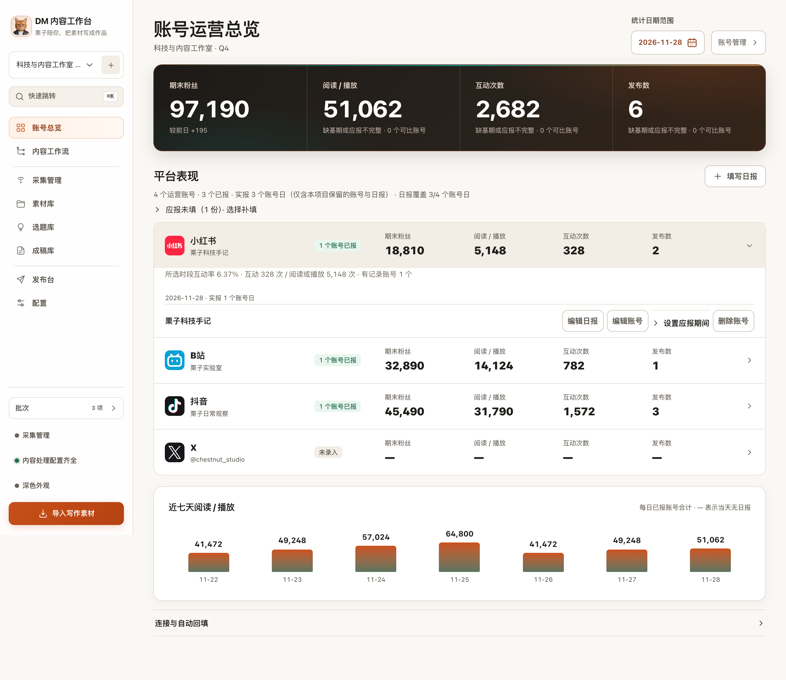
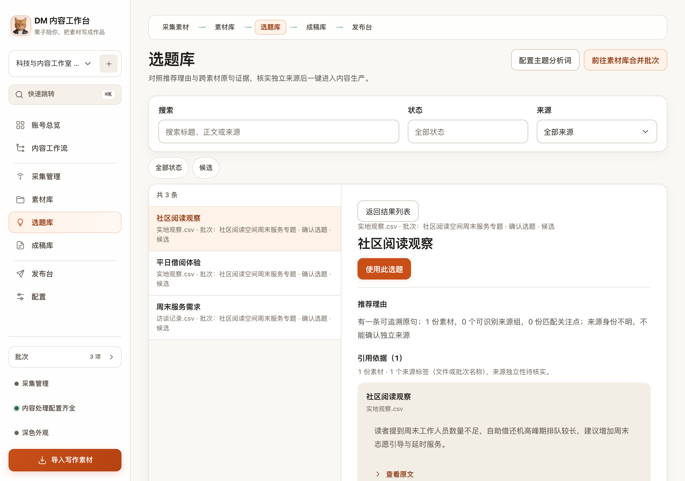

<div align="center">

# DM Content Workbench (`DM-Content-Workbench`)

**Turn scattered interviews and multi-platform materials into evidence-backed topics and reviewed drafts — with deep browser collection, verbatim evidence verification, versioned draft archiving, and multi-platform account analytics in one local SQLite workspace**

<p>
  <a href="README.md"></a>
  <a href="README_EN.md"></a>
  <a href="https://github.com/dylanma8232-art/DM-Content-Workbench/releases/latest"></a>
  
  
  <a href="LICENSE"></a>
</p>

[Highlights](#highlights) · [Quick Start](#quick-start) · [What's New in v2.0](#whats-new-in-v20) · [Core Capabilities](#core-capabilities) · [Changelog](CHANGELOG.md) · [License](#license)

</div>

---

## Highlights

<p align="center">
  
</p>

<table>
  <tr>
    <td width="50%" align="center" valign="top">
      
      <br><sub><b>Evidence-backed topics</b>: verify every suggested angle against verbatim source quotes and visual observations</sub>
    </td>
    <td width="50%" align="center" valign="top">
      
      <br><sub><b>Versioned review & one-click publish</b>: review decisions bind to exact draft versions, ready for Notion/Feishu archiving or extension draft filling</sub>
    </td>
  </tr>
</table>

---

## Quick Start

Requires **Python 3.12** (UI is in Simplified Chinese; works 100% locally with SQLite and no external cloud accounts required):

```bash
git clone https://github.com/dylanma8232-art/DM-Content-Workbench.git
cd DM-Content-Workbench

python3.12 -m venv .venv
.venv/bin/python -m pip install -r requirements.txt
.venv/bin/python tools/start_local_workbench.py --no-browser
```

Open `http://127.0.0.1:8765` in your browser (or double-click `启动工作台.command` on macOS). For Docker self-hosting, run `docker compose up --build -d --wait`.

## What's New in v2.0

- **Chestnut IP & Dual Studio Themes**: Warm Stone Light mode (`#FAF8F4`) and Obsidian Dark Studio mode (`html[data-dm-theme="dark"]`) with one-click toggle in the sidebar and `⌘K` command palette, plus redesigned self-contained browser extension popup (`popup.html`) and Douyin connect card (`douyin-connect.html`).
- **Live Data-Flow Pipelines & Micro-Interactions**: 5-step production pipeline bar (`Collect → Materials → Topics → Drafts → Publish`), 4-node live collection progress strip (`List Probe → Detail Expansion → Subtitle/ASR → Frame OCR & Ingest`), sticky glassmorphism stage bar, and floating material collection dock.
- **Multimodal Deep Collection & Local AI**: Companion Chrome/Edge extension for deep collection across Xiaohongshu, Bilibili, Douyin, YouTube, X, Instagram, and TikTok, paired with local image storage, Apple Vision / Tesseract OCR, local Whisper.cpp / MLX speech transcription, and one-click gap reprocessing.
- **Online Library Sync & Publishing Desk**: Bi-directional Notion database and Feishu Bitable integration (import materials + archive approved drafts) and a dedicated Publishing Desk that fills approved drafts into creator studio forms via the companion extension.

See the full Chinese guide in [README.md](README.md) and the complete iteration history in [CHANGELOG.md](CHANGELOG.md).

---

## License

Licensed under **[CC BY-NC-SA 4.0](LICENSE)** (Creative Commons Attribution-NonCommercial-ShareAlike 4.0 International) for personal and non-commercial use. Commercial use is prohibited; adaptations must preserve attribution and be shared under the same license. See [LICENSE](LICENSE) and [NOTICE](NOTICE).

## Author

Built by **[dylanma8232-art](https://github.com/dylanma8232-art)** · **[Visit profile for more open-source projects →](https://github.com/dylanma8232-art)**
